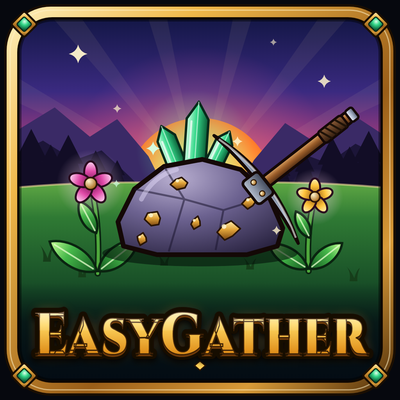

# EasyGather — Mining and Herbalism helper for World of Warcraft: Forever

A small, lightweight gathering addon. It shows what a node needs and what it's worth, remembers where you found it,
and tracks what your gathering earns. Everything is information; it never gathers or clicks anything for you.

## Install
1. Find your Forever install: `World of Warcraft\_forever_\`.
2. Copy the `EasyGather` folder into `<that folder>\Interface\AddOns\` so you have `...\AddOns\EasyGather\EasyGather.toc`.
3. `/reload` or restart, and enable it on the AddOns screen. `/eg` lists the commands; there is also a minimap button.

## Features

### Skill and price on node tooltips
- Hover any ore vein or herb in the world to see the required skill and the current AH price for one item.
- The skill is coloured by your own level: red (can't gather yet), orange, yellow, green, grey (no more skill-ups).

### Saved nodes
- Every node you gather is saved with its position, how many times you've gathered it and when.
- **Minimap:** a tiny red dot per saved node, small enough to sit inside the game's own node icon so you can still
  see whether the node is up. Hover it for skill, price and history.
- **World map:** item icons mark your saved nodes; the **My gathered nodes** checkbox on the map shows or hides them.
- Nodes you tried without enough skill are saved too and marked with a red X on the world map.

### Scarce drops
- Tracks how often each node type gives something rare besides its main item (gems, Elemental Earth, Black Vitriol,
  Swiftthistle, Wildvine...). Common stones aren't counted.
- Shown in node tooltips, e.g. `Scarce drops: 12% (3 of 25)`, with your most common finds.

### Gold per hour bar
- A slim bar at the top of the screen: **Gold/hr**, **Gathered** (ore and herbs at AH price), overall **Scarce**
  rate, **Vendor** (grey and white mob drops at vendor price), **Coin** looted and session **Time**.
- Hover Scarce for your top 5 node types by scarce rate. Right-click EG or Time to reset the session.
- Counts only time you're logged in and carries over `/reload` and logouts.
- With **AHledger** installed it sits right below AHledger's bar and moves with it.

### AH prices
- Uses **Auctionator** prices when Auctionator is installed.
- Otherwise click **Scan Ore/Herbs** at the top of the Auction House (or `/eg scan`).

## Commands

| Command | What it does |
|---|---|
| `/eg` | List all commands |
| `/eg scan` | Scan AH prices for ore and herbs (Auction House must be open) |
| `/eg list` | Nodes saved in your current zone |
| `/eg minimap` / `/eg map` | Show or hide minimap / world map pins |
| `/eg gph` | Show or hide the gold per hour bar |
| `/eg reset` | Start a new gold per hour session |
| `/eg button` | Show or hide the minimap button |
| `/eg clear` / `/eg clear all` | Delete saved nodes for this zone / everywhere |

**Minimap button:** left-click toggles pins, right-click shows or hides the gold per hour bar, shift-right-click
lists this zone's nodes. Drag to move.

## Good to know
- The game blocks addons from reading the names of its own minimap node icons, so EasyGather can't add skill or
  price to the game's minimap tooltip. It shows them on the world node tooltip and on its own pins instead.
- A node needs to be gathered (or attempted) once before it gets a pin.

## Releasing
Push a version tag and GitHub Actions packages the addon (see `.pkgmeta`) and publishes it:

```
git tag -a v1.0.0 -m "EasyGather 1.0.0"
git push origin v1.0.0
```

The CurseForge upload needs the `CF_API_KEY` repository secret and `## X-Curse-Project-ID` in `EasyGather/EasyGather.toc`.

## Branding
`python branding/make_logo.py` redraws the logo (needs Microsoft Edge for rendering). Lettering is Cinzel, under the
SIL Open Font License (`branding/fonts/OFL.txt`).
